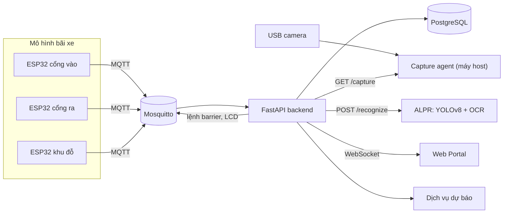
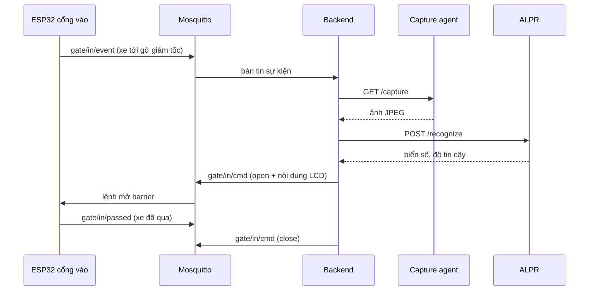
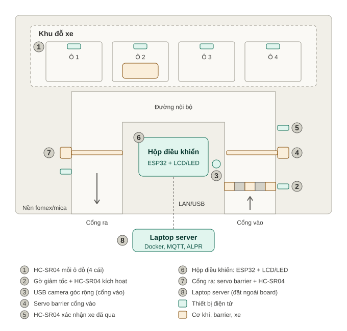

# Smart Parking System

Hệ thống quản lý bãi xe thông minh: cảm biến ở gờ giảm tốc tự kích hoạt nhận diện biển số bằng AI chạy cục bộ, điều khiển barrier, theo dõi ô đỗ theo thời gian thực. Đồ án chuyên ngành Mạng máy tính.

**Đề tài:** Quản lý Bãi xe Thông minh & Điều phối Giao thông Nội bộ tích hợp Docker, Local AI OCR và Cảm biến Mạng.

## Tính năng

- Xe qua gờ giảm tốc thì ESP32 báo sự kiện qua MQTT, hệ thống tự chụp ảnh và đọc biển số (YOLOv8 + OCR, mục tiêu dưới 500 ms).
- Mở và đóng barrier bằng servo, hiển thị biển số và số ô trống lên LCD/LED.
- Theo dõi 4 ô đỗ bằng cảm biến siêu âm HC-SR04, đẩy trạng thái lên Web Portal qua WebSocket.
- Điều phối nội bộ: gợi ý khu còn chỗ, dự báo mật độ bằng mô hình học máy.
- Toàn bộ dịch vụ đóng gói bằng Docker Compose (riêng `capture-agent` chạy ngoài Docker).

## Kiến trúc



> `capture-agent` **không chạy trong Docker**: truyền USB camera vào container trên Windows khá rắc rối. Nó mở API `GET /capture` trả ảnh JPEG trên cổng 8002, backend gọi vào đó.

### Luồng xe vào



## Mô hình

Bố cục tấm nền (nhìn từ trên xuống): khu đỗ 4 ô, cổng vào có gờ giảm tốc, camera, barrier và cảm biến xác nhận, cổng ra, hộp điều khiển ESP32 ở giữa.



> Khi mô hình làm xong, thêm ảnh chụp thật vào `docs/images/` và chèn vào đây.

## Công nghệ

| Lớp | Công nghệ |
|---|---|
| Thiết bị | ESP32, HC-SR04, servo SG90, LCD I2C, USB camera |
| Truyền thông | MQTT (Mosquitto), WebSocket, REST |
| Backend | FastAPI, SQLAlchemy, PostgreSQL |
| AI cục bộ | YOLOv8n (cắt biển số), EasyOCR hoặc PaddleOCR; Random Forest dự báo mật độ |
| Triển khai | Docker Compose |

## Cấu trúc repo

```
├── AGENTS.md            quy tắc cho AI agent
├── docs/                CONTRACT.md (topic MQTT, CSDL, API), GIT_WORKFLOW.md
├── docker-compose.yml   Mosquitto + PostgreSQL + backend
├── .env.example         mẫu cấu hình (bản thật .env không được commit)
├── backend/             FastAPI: MQTT, REST, WebSocket, PostgreSQL
├── alpr/                YOLOv8 + OCR, API nhận ảnh (cổng 8001)
├── capture-agent/       chụp ảnh từ USB camera, chạy trên máy host (cổng 8002)
├── forecast/            AI dự báo mật độ
├── portal/              Web Portal
├── firmware/            ESP32: gate_in, gate_out, slots (PlatformIO)
└── tools/               script giả lập, đo đạc
```

## Chạy nhanh

1. `cp .env.example .env` rồi điền `POSTGRES_PASSWORD` và **đồng bộ cùng giá trị trong `DATABASE_URL`**.
2. `docker compose up --build`
3. Mở http://localhost:8000/api/health (mong đợi `mqtt_connected: true`) và http://localhost:8000/docs
4. Giả lập thiết bị khi chưa có phần cứng:
   ```bash
   pip install -r tools/requirements.txt
   python tools/sim_esp32.py --host localhost --interval 2
   ```
5. Kiểm tra `GET /api/slots` đổi trạng thái theo simulator.

Cấu hình Mosquitto hiện cho phép kết nối ẩn danh để phát triển. Bật xác thực trước khi demo thật.

Firmware ESP32 (nạp qua PlatformIO):

```bash
cd firmware/gate_in
# sửa include/config.h: WiFi + MQTT_HOST = IP LAN của máy chạy docker compose
pio run -t upload && pio device monitor
```

## Hợp đồng giữa các module

Mọi module phải khớp [docs/CONTRACT.md](docs/CONTRACT.md) — muốn đổi topic/schema/API thì sửa file đó trước, báo cả nhóm và cập nhật trong cùng commit.

**Topic MQTT** (tiền tố `parking/`):

| Topic | Hướng | Nội dung |
|---|---|---|
| `gate/in/event` | ESP32 → | `{"type":"vehicle_detected","distance_cm":35.2,"ts":...}` (cảm biến ở gờ giảm tốc) |
| `gate/in/passed` | ESP32 → | `{"type":"vehicle_passed","ts":...}` (cảm biến sau barrier) |
| `gate/in/cmd` | ← Backend | `{"barrier":"open"\|"close","lcd":["dòng 1","dòng 2"]}` |
| `gate/out/*` | hai chiều | Như cổng vào |
| `slot/<n>/state` | ESP32 → | `{"slot":1,"occupied":true,"distance_cm":8.4,"ts":...}` (`n` = 1..4) |
| `device/<id>/status` | ESP32 → | `online`/`offline` (retained, dùng last will; `id` = `gate_in`\|`gate_out`\|`slots`) |

**CSDL:** `slots`, `events` (jsonb), `sessions`, `plate_reads`.

**API:**

| Dịch vụ | Cổng | Endpoint |
|---|---|---|
| Backend | 8000 | `GET /api/health`, `/api/slots`, `/api/events`, `/api/sessions`, `WS /ws` |
| ALPR | 8001 | `POST /recognize` → `{"plate":"29B-12345","confidence":0.91,"ms":320}` |
| Capture | 8002 | `GET /capture` → ảnh JPEG (chạy ngoài Docker) |

`GET /api/stats` và `GET /api/forecast` sẽ thêm ở giai đoạn 6.

> **Gợi ý sơ đồ chân ESP32** (người kiểm tra lại khi đấu dây thật): HC-SR04 TRIG ở GPIO 25, 26, 27, 14; ECHO ở GPIO 34, 35, 32, 33 (qua cầu phân áp); servo GPIO 18; LCD I2C SDA 21, SCL 22. Chân thật khai báo trong `firmware/<board>/include/config.h`.

## Quy tắc làm việc với AI agent

Chi tiết trong [AGENTS.md](AGENTS.md). Tóm tắt:

1. **Viết hợp đồng trước, code sau** — chốt topic MQTT, schema CSDL, API trong `docs/CONTRACT.md`, mọi lần nhờ AI đều đính kèm file này.
2. **Mỗi phiên làm một module nhỏ** — chạy thử rồi commit, không nhờ AI viết lại cả dự án.
3. **Mô phỏng trước, phần cứng sau** — `tools/sim_esp32.py` để backend chạy được khi hàng chưa về.
4. **Người kiểm tra những gì AI không thể kiểm tra** — sơ đồ chân, điện áp, nguồn servo. AI không nhìn thấy mạch của bạn.
5. **Đọc diff trước khi chấp nhận** — không để mật khẩu trong code (dùng `.env`).
6. Chỉ sửa module được giao, không refactor file khác; cấu hình để trong `.env` hoặc `config.h`.

## Lộ trình

| Giai đoạn | Tuần | Việc | Tiêu chí hoàn thành | Trạng thái |
|---|---|---|---|---|
| 0. Khung dự án | 3 | Cấu trúc repo, AGENTS.md, CONTRACT.md, docker-compose | `docker compose up` chạy Mosquitto + PostgreSQL | ✅ |
| 1. Backend lõi | 3 | FastAPI nhận MQTT, lưu CSDL, REST + WebSocket, simulator | Simulator gửi bản tin → dòng mới trong CSDL và qua WebSocket | ✅ |
| 2. Firmware | 3–4 | 3 sketch ESP32 (cổng vào, cổng ra, khu đỗ) | Gửi đúng topic lên broker thật, nhận lệnh mở barrier | 🟡 `gate_in` đã viết, còn `gate_out`, `slots` và test phần cứng |
| 3. Dịch vụ ALPR | 4–5 | API nhận ảnh, YOLOv8n cắt biển, OCR, kiểm tra biển Việt Nam | Chạy trên thư mục ảnh mẫu, có script đo thời gian | ⬜ |
| 4. Luồng cổng | 5–6 | Backend điều phối: nhận `vehicle_detected` → `/capture` → ALPR → mở barrier → ghi phiên | Chạy trọn luồng với giả lập, rồi thiết bị thật | ⬜ |
| 5. Web Portal | 6–7 | Lưới ô đỗ thời gian thực, lịch sử, tìm biển số, thống kê | Portal hiển thị đúng trạng thái realtime | ⬜ |
| 6. AI dự báo | 8 | Dữ liệu mô phỏng, Random Forest, API dự báo, hiện lên portal | Dự báo trả về và hiển thị được | ⬜ |
| 7. Đo đạc | 9 | Đo độ trễ cảm biến→barrier, độ chính xác ALPR, xuất CSV | Có CSV số liệu | ⬜ |
| 8. Hoàn thiện | 10 | Healthcheck, restart policy, README, kịch bản demo | Demo chạy trọn | ⬜ |

<details>
<summary><b>Prompt mẫu cho 3 module quan trọng</b> (mỗi prompt đều bắt đầu bằng "Đọc AGENTS.md và docs/CONTRACT.md.")</summary>

**Giai đoạn 1 — backend lõi**

> Viết backend/ bằng FastAPI: 1) Subscribe `parking/#` qua paho-mqtt, ghi mọi bản tin vào bảng `events`. 2) Cập nhật `slots` khi nhận `slot/<n>/state`, đẩy `slot_update` qua WebSocket `/ws`. 3) REST: `GET /api/slots`, `GET /api/sessions`. 4) SQLAlchemy + PostgreSQL, cấu hình qua `.env`. Kèm `tools/sim_esp32.py` giả lập 4 ô đổi trạng thái ngẫu nhiên. Tiêu chí: chạy simulator thì `GET /api/slots` đổi theo. Chỉ sửa `backend/` và `tools/`.

**Giai đoạn 2 — firmware cổng vào**

> Viết `firmware/gate_in` (PlatformIO, ESP32 Arduino): hai HC-SR04 — A ở gờ giảm tốc (kích hoạt), B sau barrier (xác nhận), lọc trung vị 5 mẫu. A thấy xe dưới 40 cm liên tục 300 ms → publish `gate/in/event`, chờ 5 s mới kích hoạt lại. B thấy xe rồi hết thấy → publish `gate/in/passed`. Nhận `gate/in/cmd`: điều khiển servo, hiện 2 dòng LCD I2C. Tự kết nối lại WiFi/MQTT, last will cho `device/gate_in/status`. Chân GPIO và thông số ở `config.h`. Không dùng `delay()` chặn vòng lặp.

**Giai đoạn 3 — dịch vụ ALPR**

> Viết `alpr/` (FastAPI, Dockerfile): `POST /recognize` nhận ảnh, YOLOv8n tìm vùng biển, cắt, OCR bằng EasyOCR (có cờ đổi PaddleOCR). Hậu xử lý: chuẩn hóa hoa, sửa nhầm 0/O, 8/B, 1/I, regex biển Việt Nam, biển 2 dòng. Trả `plate`, `confidence`, `ms`; nạp model một lần khi khởi động. Kèm `tools/bench_alpr.py` in tỉ lệ đúng và p50/p95. Mục tiêu dưới 500 ms trên CPU.

</details>

## Tài liệu

- [Hợp đồng MQTT, CSDL, API](docs/CONTRACT.md)
- [Quy trình làm việc với Git](docs/GIT_WORKFLOW.md)
- [README backend](backend/README.md) · [README firmware gate_in](firmware/gate_in/README.md)

## Nhóm thực hiện

Võ Quốc Trí, Nguyễn Văn Trưởng. Giảng viên hướng dẫn: Lê Anh Huy. Trường Đại học Công nghệ TP.HCM (HUTECH).